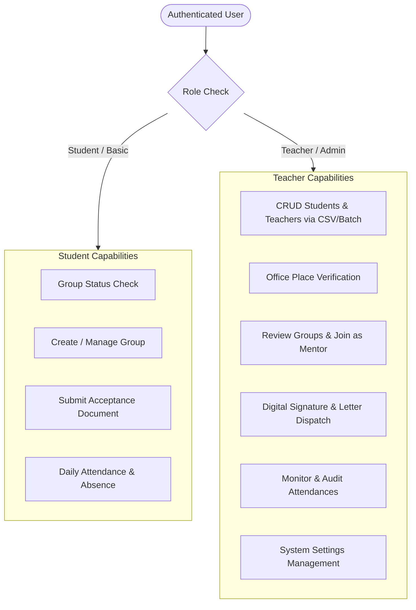
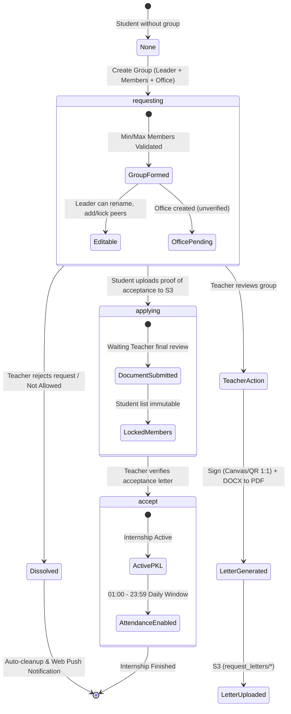

# Backend Workflow & Architecture Specification: E-PKL Cakrawala

## 1. Executive Overview

**E-PKL Cakrawala** is a comprehensive field internship (_Praktik Kerja Lapangan_ / PKL) management system tailored for vocational high schools (SMK). It streamlines student group formation, industry partner (_office/DUDI_) verification, official internship submission letters, proof of acceptance workflows, biometric-like geolocation presences, and document lifecycle management.

---

## 2. Standardized API Response Contract

All backend API endpoints follow a strict, unified envelope structure validated using **Zod** schemas:

### 2.1 Single Resource / Mutation Response

```json
{
  "data": {
    "id": "018d0000-0000-7000-8000-000000000001",
    "name": "Kelompok RPL 1",
    "status": "requesting"
  }
}
```

### 2.2 List / Paginated Collection Response

```json
{
  "list": [
    { "id": "018d0000-0000-7000-8000-000000000001", "name": "Kelompok 1" },
    { "id": "018d0000-0000-7000-8000-000000000002", "name": "Kelompok 2" }
  ],
  "id_next": "018d0000-0000-7000-8000-000000000030"
}
```
_(When no more records are available, `id_next` returns `null`)._

### 2.3 Error Envelope Response

```json
{
  "error": {
    "status": 400,
    "message": "Reason description must be greater than 30 characters."
  }
}
```

---

## 3. Zod Validation Specifications

All incoming request payloads and query parameters are strictly validated using Zod:

```typescript
import { z } from "zod";

// 1. Auth Validation
export const LoginSchema = z.object({
  username: z.string().min(3),
  password: z.string().min(6),
});

// 2. Group Creation & Modification
export const CreateGroupSchema = z.object({
  name: z.string().min(3).max(100),
  office_id: z.string().uuid(),
  member_ids: z.array(z.string().uuid()).min(1),
});

export const UpdateGroupSchema = z.object({
  name: z.string().min(3).max(100).optional(),
  member_ids: z.array(z.string().uuid()).optional(), // Mutated only in requesting status
});

// 3. Office Schema
export const CreateOfficeSchema = z.object({
  name: z.string().min(3),
  address: z.string().min(5),
  field: z.string().optional(),
  phone: z.string().optional(),
  email: z.string().email().optional(),
  website: z.string().url().optional(),
  quota: z.number().int().positive().optional(),
});

// 4. Attendance & Absence
export const SubmitAttendanceSchema = z.object({
  status: z.literal("present"),
  latitude: z.number().min(-90).max(90),
  longitude: z.number().min(-180).max(180),
  image_key: z.string().min(1), // S3 path attendances/*
});

export const SubmitAbsenceSchema = z.object({
  status: z.enum(["sick", "permission"]),
  notes: z.string().min(31, "Notes must be greater than 30 characters"),
  latitude: z.number().min(-90).max(90),
  longitude: z.number().min(-180).max(180),
  document_key: z.string().optional(), // S3 path absences/*
});

// 5. Letter Generation & Digital Signature
export const GenerateLetterSchema = z.object({
  signature_type: z.enum(["canvas", "qr_code"]),
  signature_data: z.string().min(1), // Base64 data URI (1:1 ratio mandatory)
});
```

---

## 4. Actors & Role-Based Access Control (RBAC)



### 4.1 Teacher / Administrator

- **Student Data Management**: Full CRUD, search, pagination (30 items/page), and batch insertion via CSV.
- **Teacher Data Management**: Full CRUD, search, pagination (30 items/page), and batch insertion via CSV.
- **Offices (DUDI) Management**: Full CRUD, review/verify unverified offices submitted by students, capacity/quota auditing.
- **Groups Management**: Inspect groups, assign/join as supervising mentor (`teacher_id`), approve or reject internship requests, dissolve groups that are not allowed.
- **Digital Signatures & Letter Generation**: Submit official request letters signed digitally (via HTML5 canvas drawing or 1:1 ratio QR code image upload) merged into dynamic DOCX templates and converted to lightweight PDF.
- **Attendance Monitoring**: View, filter, and audit attendance/absence across all or specific groups, with emergency override/deletion.
- **System Settings**: Configure global rules such as minimum and maximum members per group (`group.rules`) and letter templates (`letter.template`).

### 4.2 Student / Basic

- **Onboarding / Group Discovery**: On login, verify membership status:
  - If member of an active group: Proceed to group dashboard or attendance.
  - If unassigned: Option to create a group (becoming Group Leader/Admin) or wait for invitations from peers.
- **Group Administration (Leader only)**:
  - Add peer students (constrained by min/max members from `settings`).
  - Select an existing verified office, or propose a new office (automatically marked unverified `is_verified: false`).
  - Modify group name, add, or kick members **strictly while in `requesting` status**.
- **Document Submission**: Upload official company acceptance letters/pictures (`applying` -> `accept`).
- **Presence & Absence Tracking**:
  - Daily check-in (`attendance`): Selfie photo + GPS coordinates + backend-validated timestamp (01:00 - 23:59).
  - Absence (`absence`): Reason description (> 30 characters), GPS, timestamp, and optional supporting document. Edit/delete window restricted to **1 hour**.

---

## 5. End-to-End Group Lifecycle State Machine



### 5.1 Status Matrix & Permissions

| Status           | Group Mutability                       | Office State                | Action Allowed by Student                   | Action Required by Teacher                                           | Next State               |
| :--------------- | :------------------------------------- | :-------------------------- | :------------------------------------------ | :------------------------------------------------------------------- | :----------------------- |
| **`requesting`** | Leader can edit name, add/kick members | Verified or Unverified      | Download generated letter once available    | Verify office, digital sign request letter, or reject/dissolve group | `applying` or `rejected` |
| **`applying`**   | Name mutable; members **locked**       | Must be verified by Teacher | Upload company acceptance proof (image/PDF) | Inspect uploaded proof                                               | `accept` or `requesting` |
| **`accept`**     | Name mutable; members **locked**       | Verified                    | Check-in attendance, file absence           | Monitor presence records, audit log                                  | Completed                |
| **`rejected`**   | Dissolved                              | -                           | Group dissolved, peers unassigned           | -                                                                    | Terminal                 |

---

## 6. Attendance & Absence Subsystem

### 6.1 Daily Attendance (`present`)

- **Active Hours**: 01:00 to 23:59 (following server/school timezone).
- **Enforcement Window**: Only accessible when group status is `accept`.
- **Payload Requirements**:
  1. **Selfie Image**: Uploaded to S3 (`attendances/*`).
  2. **Geolocation**: Latitude and Longitude recorded from client GPS.
  3. **Timestamp**: Verified and generated strictly by the backend to prevent client clock tampering.
- **Constraints**: Exactly 1 attendance record per student per calendar date (`UNIQUE(user_id, date)`).

### 6.2 Absence Filing (`sick` / `permission`)

- **Reason Description**: Mandatory text explanation of **greater than 30 characters**.
- **Evidence Attachment**: Supporting document/photo uploaded to S3 (`absences/*`) — optional but strongly recommended.
- **Geolocation & Timestamp**: Mandatory metadata.
- **Grace Period**: Students have a strict **1-hour window** from submission to update or delete their absence record. After 60 minutes, the record is locked permanently.

---

## 7. Storage Architecture & Cloud Retention Policies

Storage is managed via Amazon S3 / RustFS with structured prefix buckets:

```
s3://cakrawala-storage/
├── template_letters/   <-- Pre-configured DOCX templates (managed by Admin)
├── request_letters/    <-- Generated signed PDF request letters (auto-deleted > 60 days)
├── attendances/        <-- Daily attendance selfie photos (auto-deleted > 240 days)
└── absences/           <-- Absence permit attachments (auto-deleted > 240 days)
```

### 7.1 Automated Cleanup Schedule & Per-File Date Evaluation (Cronjobs)

To conserve storage and maintain data privacy, lifecycle policies are evaluated **per individual file based on its creation date / upload timestamp**, rather than performing bulk or blanket folder purges:

1. **Per-Object Timestamp Validation**:
   - Every file uploaded to S3 retains standard object metadata (`LastModified` and custom header `"date-upload": new Date().toISOString()`).
   - The deletion scheduler queries object metadata individually or via batch list tokens before deciding deletion.
   - A file is **never deleted arbitrarily**; it is purged **only if and when its own age strictly exceeds** the threshold:
     $$\text{File Age} = \text{Current Time} - \text{File Created Timestamp} > \text{Threshold}$$

2. **Retention Thresholds by Category**:
   - **Request Letters (`request_letters/*`)**:
     - Evaluated file-by-file.
     - Deleted strictly when individual file age **> 60 days**.
     - Files newer than 60 days are kept intact.
   - **Attendance & Absence Assets (`attendances/*`, `absences/*`)**:
     - Evaluated file-by-file.
     - Deleted strictly when individual file age **> 240 days** (~8 months, covering the full vocational academic PKL period).
     - Newer attendance evidence within the 240-day window remains untouched.
   - **Template Letters (`template_letters/*`)**:
     - **Permanent / Excluded from auto-cleanup** (master administrative templates).

3. **Audit Trail**:
   - Every individual pruned file key along with its evaluated creation date and deletion timestamp is written to the system audit log.
